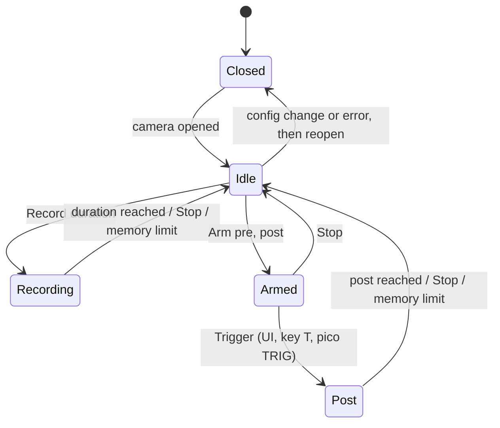

# Architecture

```mermaid
classDiagram
    class CaptureThread {
        +Device dev
        +MmapStream stream
        +Mode mode
        +on_frame(data, seq, ts_us)
        +handle(Cmd)
        +finish()
    }
    class Shared {
        +Mutex~Device~ device
        +watch~Status~ status
        +watch~Frame~ preview
        +Mutex~Recording~ recording
        +broadcast~Event~ events
    }
    class Recording {
        +RecordingMeta meta
        +Vec~Frame~ frames
        +save(dir)
        +load(dir)
    }
    class Api {
        +/api/status, /api/ws
        +/api/preview.mjpg
        +/api/camera/*
        +/api/capture/*
        +/api/recording/*
        +/api/recordings/*
        +/api/trigger/*
    }
    class TriggerLink {
        +connect(port)
        +send(line)
        +reader task: TRIG -> Cmd::Trigger
    }
    class WebUI {
        +Store state
        +Timeline canvas
        +Viewer
        +Panels: markers, camera, trigger, files
    }
    class PicoFirmware {
        +input_task GP2
        +periodic_task
        +trigger_task GP3 GP4
        +cdc_reader / cdc_writer
    }
    CaptureThread --> Shared : publishes
    Api --> Shared : reads
    Api --> CaptureThread : Cmd via mpsc
    TriggerLink --> CaptureThread : Cmd::Trigger
    TriggerLink --> Shared : events
    Api --> TriggerLink : connect, send
    WebUI --> Api : HTTP, WebSocket, MJPEG
    PicoFirmware --> TriggerLink : USB CDC lines
    Shared --> Recording : holds
```

## Capture modes



## Armed capture against time

Pre-roll 1 s and post-roll 1 s at 200 fps. Only the last pre-roll seconds of
the ring buffer survive; frames before that are discarded as they age out.

```mermaid
gantt
    title Armed capture, trigger at t = 2.5 s
    dateFormat x
    axisFormat %S.%L s
    section Camera
    streaming at 200 fps            :active, s1, 0, 4000
    section Ring buffer
    frames aging out (discarded)    :done, r1, 0, 1500
    kept as pre-roll                :r2, 1500, 2500
    section Capture
    trigger                         :milestone, t1, 2500, 0
    post-roll recorded              :crit, p1, 2500, 3500
    recording ready, UI switches    :milestone, m1, 3500, 0
```



## Data flow for one frame

1. V4L2 dequeues a buffer with sequence number and timestamp.
2. MJPG frames are copied as is; YUYV and GREY are JPEG encoded on the host.
3. The frame goes into the preview watch channel (browser gets at most 30 fps)
   and, depending on mode, into the recording or the pre-roll ring.
4. When a capture finishes the frames become a `Recording` with relative
   timestamps, dropped frame count and markers; the UI is told over the
   WebSocket and fetches metadata and frames on demand.
